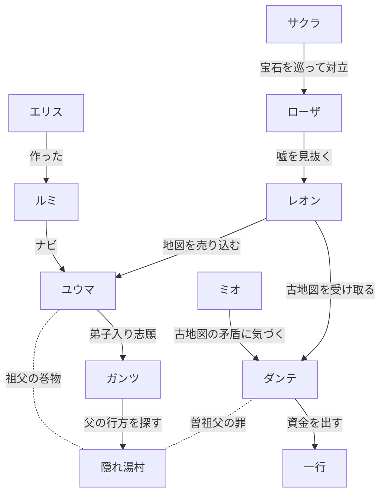

# 廃村の蒼き秘宝 設定集 v1.0（2026-11-23）

> 「その村に入った者は、宝を見つけるまで帰れない。」
> サウンドノベル／全6章／60〜90分／END3種。怖さは不気味さ中心で、残酷な描写はしない。

## 1. 舞台と伝説
- **隠れ湯村（かくれゆむら）**：山奥の元・温泉村。100年前のある夜、村人が一夜で姿を消した。残ったのは崩れた家、骸骨、鳴らない鐘楼、枯れた湯船
- **龍神の珠（りゅうじんのたま）**：村の地下にあると噂される世界最大の宝石。村の守り神「湯の龍神」の宝とされる蒼い珠。源泉の底で蒼く光り、その熱で村の湯を温めていた
- **100年前の真相**（第5章で判明）
  - 鉱山主・黒崎が龍神の珠を掘り出そうとして、源泉から毒の湯気が噴き出した
  - 村人は一夜で山向こうへ逃げた。消えたのではなく、逃げのびていた
  - 村に残る骸骨は、その後に宝を狙って入り込んだ盗掘者たちのもの
  - 最後まで残った湯守（ゆもり）の一族が、罠を仕掛けて龍神の珠を封印した

## 2. 登場人物
| No | 名前 | 役 | 性格・口ぐせ | 隠していること | 得意なこと |
|---|---|---|---|---|---|
| 01 | ユウマ | 主人公・トレジャーハンター見習い | 直感と好奇心で動く。「当たりカード、引いてみせる！」 | 祖父の形見の巻物に、龍神の珠と鐘楼が描かれている | 運と勘。巻物の絵と村の景色を見比べて暗号のヒントに気づく |
| 02 | ガンツ | ベテラン採掘師 | 豪快で面倒見がいい。罠には人一倍慎重 | 父が20年前にこの村で行方不明になった | 罠や崩落を見抜く。力仕事、ツルハシ |
| 03 | レオン | 投資家・情報屋 | 冷静で計算高い。「リターンが見合うかな」 | 古地図はダンテから受け取って流したもの | 情報の裏読み、数字の暗号 |
| 04 | エリス | 錬金術師・科学者 | 明るく好奇心旺盛。実験で何かを爆発させがち | 龍神の珠を「宝」ではなく「熱を生む鉱物」として見ている | 薬品・鉱物の分析、毒の湯気の中和。相棒ルミを作った |
| 05 | ローザ | カジノの女王 | 余裕たっぷりの駆け引き上手。「賭けは降りた方が負けよ」 | 借金を返すため、この賭けに全てを張っている | 人の嘘を見抜く。仲間割れを止める（煽ることもある） |
| 06 | ミオ | 地図屋の少女 | 物静かでしっかり者。通った道は全部描く | 古地図と村の配置が合わない理由に、早い段階で気づいている | 地図・方角・地形。迷宮で道を決める |
| 07 | サクラ | 古美術鑑定士 | 上品だが、宝石の話になると目の色が変わる | 龍神の珠を自分の手で鑑定することに取りつかれている | 古文字・暗号の解読、宝石の真贋 |
| 08 | ダンテ | 大富豪・探索のスポンサー | 陽気で気前がいい。「金で買えない物はない……はずだ」 | 鉱山主・黒崎のひ孫。曽祖父の罪を知っている | 資金と装備。終盤、湯守の一族との因縁の鍵になる |

### 相棒ナビ「ルミ」
- エリスが作った鉱石ランタン型の小さなナビ。ふわふわ浮いて青白く光る
- 場面の解説、ヒント出し（同じ場所で3回空振りしたら）、ユウマへのツッコミ担当
- 口調は丁寧だけど毒舌。「ユウマさん、それは壁です。3回目です」
- 龍神の珠に近づくほど光が強くなる。この光が「宝石レーダー」になる

### 関係図

## 3. 全6章のあらすじ
| 章 | 舞台 | 何が起きる | 謎解き | 罠・危険 |
|---|---|---|---|---|
| 1 誰もいない村 | 村の入口・広場・湯屋 | 8人が集合。古地図と伝説を確認。枯れた湯屋で、まだ温かい岩を見つける | ①古地図と村の配置のずれ（ミオ） | 崩れかけの橋、霧で迷う |
| 2 骸骨の酒場 | 酒場・地下倉庫 | 骸骨のそばに古い鍵と、盗掘者の日記。床下から規則的な音 | ②日記の日付順並べ替え ③鍵の刻印（サクラ） | **罠突破パート1**：動き出す骸骨（やさしめ） |
| 3 鳴らない鐘楼 | 鐘楼・湯守の屋敷 | 鐘の音に隠された暗号。湯守の一族の存在が浮かぶ。ユウマの祖父の巻物と鐘楼の絵が一致 | ④鐘の打つ回数→文字入力の合言葉 ⑤巻物の絵合わせ（ユウマ） | 落ちてくる鐘、腐った階段 |
| 4 地下迷宮【3Dダンジョン】 | 坑道・石像の回廊 | この章だけ一人称の3D迷宮に切り替わる（ウィザードリィ風・1マスずつ進んで90度ずつ向きを変える）。落とし穴・仕掛け扉・動く石像。ガンツの父の手掛かりを見つける。仲間割れの危機 | ⑥迷宮の道順（ミオの地図） ⑦数字錠（レオン） | **罠突破パート2**：石像の回廊（山場・難しい。直前に自動セーブ） |
| 5 封印された扉 | 封印の間 | 100年前の真相。ダンテの正体と、それぞれの隠し事がつながる | ⑧毒の湯気の中和（エリス） ⑨封印の合言葉（文字入力） | 噴き出す湯気、時間制限つきの選択 |
| 6 世界最大の宝石 | 蒼く光る源泉の宝物庫 | 龍神の珠を発見。持ち帰るか、守るか、別の道を探すかを選ぶ | ⑩台座の仕掛け（全員の得意技を使う） | 宝物庫の崩落 |

## 4. エンディング（どのルートでも宝石は必ず見つかる）
| END | 条件 | 結末 |
|---|---|---|
| A 龍神の珠を持ち帰る | 第6章で「持ち帰る」を選ぶ | 世界一の富を手にする。だが源泉は冷え、村は二度と戻らない |
| B 封印を守る | 「ここに残す」を選ぶ | 龍神の珠は源泉の底へ。一行は記録だけを持ち帰り、湯がよみがえる |
| C 真END 蒼き湯の帰還 | 手掛かり8つ以上＋信頼が一定以上＋ダンテの告白を聞いた状態で「別の道を探す」 | エリスの分析とガンツの掘削で、龍神の珠を傷つけずに湯の流れを戻す。村人の子孫が帰り、龍神の珠は村の宝として世界に知られる |

## 4.5 第4章 3Dダンジョン（地下迷宮）
- 見え方：一人称視点。1マスずつ前進・後退、90度ずつ左右を向く。足音と松明の揺れ
- 操作：PCは矢印キー／WASD、スマホは画面下の十字ボタン
- 自動マップ：ミオが歩いたマスを手帳に描く。古地図と重ねると「ずれ」が分かる
- 罠：落とし穴（ガンツが事前に気づく）、仕掛け扉（レオンの数字錠）、毒の湯気（エリス）、動く石像（3×3の罠突破パートへ）
- 相棒ルミ：龍神の珠の方向へ近づくほど明るくなる＝宝石レーダー
- 広さ：10×10マス×2階程度。迷っても15分以内に抜けられるようにする
- 名前・絵・音はすべてオリジナル（ウィザードリィは「遊び方」だけ参考）

## 5. システムの基本
- 進め方：本文を読む区間 ⇄ コマンド区間（見る／調べる／話す／使う／仲間に聞く／移動）
- 数値：手掛かり・信頼（仲間ごと）・LIFE（罠突破パートのみ）
- 罠に失敗：ゲームオーバーにせず、ケガ・信頼低下・遠回り。直前から選び直せる
- 探検手帳：人物・場所・手掛かり・古文字を自動で記録・検索
- 寄り道：各章に「おもしろコマンド」と隠しイベントを1つずつ

## 6. 素材
- 立ち絵：`Art/Characters/D117_NN_<名前>_front.png`（8人・正面・透過）
- 顔アップ：`Art/Faces/`（ユウマ・エリスの笑顔）
- 表情差分（通常・笑顔・驚き・恐怖・怒り・思案）：設定画にある2表情から使い、足りない分は元の絵柄のまま追加で作る
- 背景：入口・広場・酒場・鐘楼・坑道・石像の回廊・封印の間・宝物庫の8枚（人物・文字なし）
- 元絵：`Art/Source/`、設定画：`Art/Reference/`、UI試作：`Reference/haison_onsen_hunter_complete.html`

## 7. 声の担当（VOICEVOX）
| 役 | 声 | 表情で切り替え |
|---|---|---|
| 語り | 青山龍星（しっとり） | － |
| ユウマ | 白上虎太郎（ふつう） | 笑顔＝わーい／恐怖＝びくびく／怒り＝おこ |
| ガンツ | ちび式じい（しゃがれ声） | 叫びは抑揚1.3 |
| レオン | 雀松朱司 | － |
| エリス | 春日部つむぎ | － |
| ローザ | 九州そら（セクシー） | 少しゆっくり・低め |
| ミオ | 冥鳴ひまり | － |
| サクラ | 四国めたん（ノーマル） | － |
| ダンテ | 麒ヶ島宗麟 | － |
| ルミ | ナースロボ＿タイプＴ | － |
- 合う声がVOICEVOXに無いキャラが出たら、AivisSpeechも使う
- クレジット表記「VOICEVOX:キャラ名」をタイトル画面に表示する
